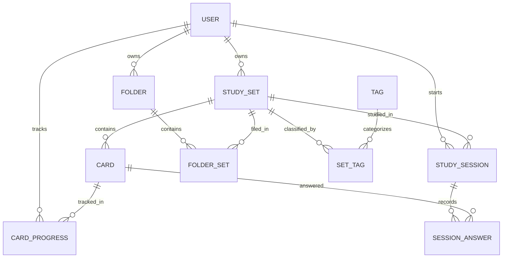

# Data model

Entities, relationships, and rules. For user flows and architecture see [flow.md](flow.md).

## 1. Principles

- User-generated data lives in PostgreSQL. Sanity holds editorial content only.
- Cards are a separate table, not a JSON array in the set, because progress and answers reference individual cards.
- Order inside a set uses an explicit `position`.
- Progress is stored per user and per card, so one public set can be studied by many users.
- `cardCount` is denormalized on the set so lists do not need to count rows.
- Persisted sessions cover signed-in users and every study mode. Quiz attempts are sessions with `mode: 'test'`; guest sessions are temporary and are not stored.
- Database types, Zod schemas, and UI view models are separate.

## 2. Entity relationship diagram



`FOLDER`, `FOLDER_SET`, `TAG`, and `SET_TAG` are phase 2. Everything else is MVP.

## 3. Types: MVP

```ts
type ID = string; // uuid or cuid

interface User {
  id: ID;
  email: string;
  name: string | null;
  image: string | null;
  role: "user" | "admin";
  createdAt: Date;
  updatedAt: Date;
  // Auth.js adds Account, Session, and VerificationToken tables
}

interface StudySet {
  id: ID;
  ownerId: ID;
  title: string;
  description: string | null;
  termLanguage: string | null; // BCP-47, e.g. 'es'. Used for lang attributes and TTS
  definitionLanguage: string | null; // e.g. 'en'
  status: "draft" | "published";
  visibility: "private" | "unlisted" | "public";
  cardCount: number; // denormalized
  publishedAt: Date | null;
  createdAt: Date;
  updatedAt: Date;
}

interface Card {
  id: ID;
  setId: ID;
  position: number; // order inside the set
  term: string;
  definition: string;
  hint: string | null;
  createdAt: Date;
  updatedAt: Date;
}

interface CardProgress {
  userId: ID;
  cardId: ID; // primary key: (userId, cardId)
  box: 1 | 2 | 3 | 4 | 5;
  dueAt: Date;
  correctCount: number;
  incorrectCount: number;
  lastReviewedAt: Date | null;
}

interface StudySession {
  id: ID;
  userId: ID; // persisted sessions belong to signed-in users
  setId: ID;
  mode: "flashcards" | "learn" | "test" | "match";
  startedAt: Date;
  finishedAt: Date | null;
  totalItems: number;
  correctItems: number;
}

interface SessionAnswer {
  id: ID;
  sessionId: ID;
  cardId: ID;
  questionType: "flip" | "multiple_choice" | "true_false" | "written";
  result: "correct" | "incorrect" | "skipped";
  givenAnswer: string | null; // for written and multiple-choice answers
  responseMs: number | null;
  answeredAt: Date;
}
```

## 4. Types: phase 2

```ts
interface Card {
  // adds to the MVP Card
  imageUrl: string | null;
  imageAlt: string | null; // required when imageUrl exists
}

interface CardProgress {
  // adds to the MVP CardProgress
  starred: boolean;
}

interface Folder {
  id: ID;
  ownerId: ID;
  name: string;
  createdAt: Date;
}

interface FolderSet {
  folderId: ID;
  setId: ID; // primary key: (folderId, setId)
  addedAt: Date;
}

interface Tag {
  id: ID;
  name: string; // unique, lowercase
}

interface SetTag {
  setId: ID;
  tagId: ID; // primary key: (setId, tagId)
}
```

## 5. Rules

### Status and visibility

| status      | visibility | Meaning                                                              |
| ----------- | ---------- | -------------------------------------------------------------------- |
| `draft`     | `private`  | Work in progress. Only the owner sees it. Drafts are always private. |
| `published` | `private`  | Finished, owner only                                                 |
| `published` | `unlisted` | Anyone with the link, not in search                                  |
| `published` | `public`   | Visible to everyone and in search                                    |

- A draft cannot be `unlisted` or `public`. Enforce this in validation and with a database check constraint.
- Publishing requires a title and at least 2 cards.
- Who can see what is described in [flow.md](flow.md#4-who-can-see-what).
- Anyone can study published public sets, and unlisted sets with the link, without signing in. Guest study state is temporary and is not persisted as a `StudySession`, `SessionAnswer`, or `CardProgress`.

### Progress (Learn mode)

- A card starts in box 1 and is due immediately.
- Correct answer: move up one box. Wrong answer: back to box 1.
- Review intervals by box: 0, 1, 3, 7, and 14 days. `dueAt = now + interval(box)`.
- Signed-in users have persistent `CardProgress`. Guests can use Learn in a temporary session, but progress is not retained after that session.

## 6. Constraints and indexes

- `Card (setId, position)` is unique.
- `StudySet (ownerId)` and `StudySet (status, visibility, updatedAt)` are indexed.
- Full-text search on `StudySet.title` and `description` (Postgres `tsvector`).
- `CardProgress (userId, dueAt)` is indexed for the due-today query.
- `SessionAnswer (sessionId)` is indexed.
- Deleting a set cascades to its cards, progress rows, sessions, and answers.
- Deleting a card cascades to its progress rows and answers.

## 7. Validation (Zod)

```ts
import { z } from "zod";

export const cardInput = z.object({
  term: z.string().trim().min(1).max(500),
  definition: z.string().trim().min(1).max(2000),
  hint: z.string().max(500).optional(),
});

export const saveDraftInput = z.object({
  title: z.string().trim().min(1).max(120),
  description: z.string().max(1000).optional(),
  cards: z.array(cardInput).max(1000),
});

export const publishSetInput = saveDraftInput.extend({
  visibility: z.enum(["private", "unlisted", "public"]),
  cards: z.array(cardInput).min(2).max(1000),
});
```

A draft can be saved with few or no cards. Publishing needs at least 2.

## 8. Sanity documents (phase 4)

| Type                | Key fields                                                    |
| ------------------- | ------------------------------------------------------------- |
| `landingPage`       | hero, sections[], seo                                         |
| `article`           | title, slug, body (portable text), author, publishedAt, tags  |
| `helpPage`          | question, answer, category, order                             |
| `curatedCollection` | title, description, setIds[] (Postgres ids stored as strings) |

Sanity only references Postgres ids. It never stores card data.
