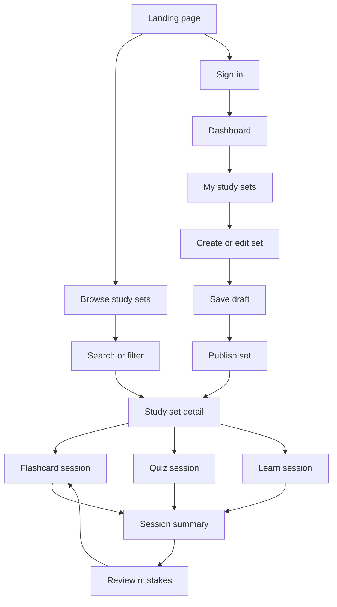
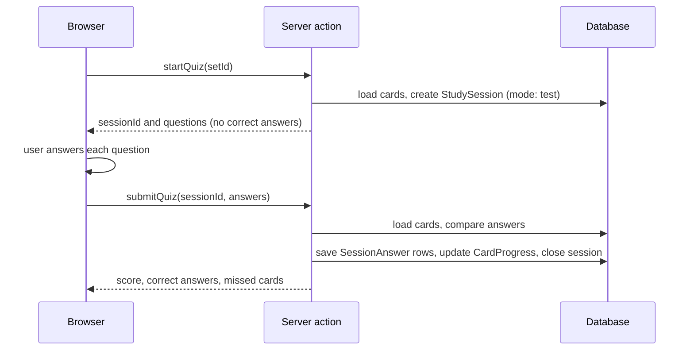
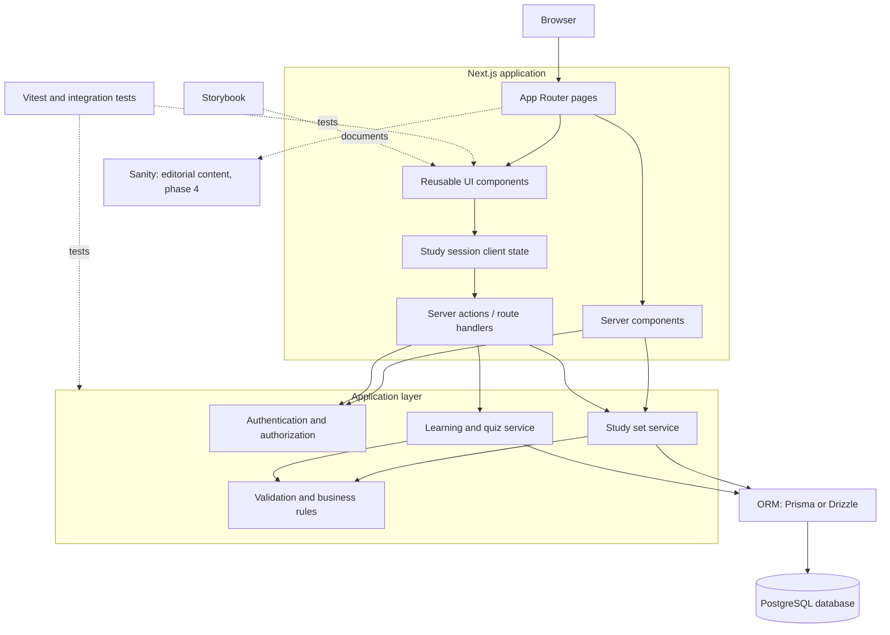

# User flows and architecture

How the app is used, how pages are organized, and how the pieces fit together.
For product scope see the [README](../README.md). For entities and types see [data-model.md](data-model.md).

## 1. Application map and user journeys



Visitors can study public sets without an account. Progress (Learn mode, starred cards, history) is saved only for signed-in users.

## 2. Quiz flow: scoring on the server



The client never decides the score. Multiple-choice options are sent to the client, but the correct option is only revealed in the result.

## 3. Routes

Route groups such as `(public)` organize the code and layouts. They do not appear in the URL.

| URL                        | Group         | Purpose                                        | Access                                          |
| -------------------------- | ------------- | ---------------------------------------------- | ----------------------------------------------- |
| `/`                        | `(public)`    | Landing page                                   | Everyone                                        |
| `/sets`                    | `(public)`    | Browse and search public sets (`?q=`, `?tag=`) | Everyone                                        |
| `/sets/[setId]`            | `(public)`    | Set detail                                     | Depends on visibility, see below                |
| `/sets/[setId]/flashcards` | `(public)`    | Flashcard session                              | Same as set detail                              |
| `/sets/[setId]/learn`      | `(public)`    | Learn session                                  | Same as set detail, progress saved if signed in |
| `/sets/[setId]/test`       | `(public)`    | Quiz session                                   | Same as set detail                              |
| `/sessions/[sessionId]`    | `(dashboard)` | Session summary and review mistakes            | Session owner                                   |
| `/login`, `/register`      | `(auth)`      | Authentication                                 | Signed-out users                                |
| `/dashboard`               | `(dashboard)` | Due cards, recent sets, streaks                | Signed-in                                       |
| `/my-sets`                 | `(dashboard)` | Your sets (drafts and published)               | Signed-in                                       |
| `/my-sets/new`             | `(dashboard)` | Create a set                                   | Signed-in                                       |
| `/my-sets/[setId]/edit`    | `(dashboard)` | Edit a set, publish, delete                    | Set owner                                       |
| `/settings`                | `(dashboard)` | Account, data export                           | Signed-in                                       |
| `/api/auth/[...nextauth]`  | `api`         | Auth.js handlers                               | Auth.js                                         |
| `/api/sets/[setId]/export` | `api`         | CSV export                                     | Same as set detail                              |

## 4. Who can see what

| Set state              | Owner | Other signed-in users | Visitors      | Appears in search |
| ---------------------- | ----- | --------------------- | ------------- | ----------------- |
| Draft                  | Yes   | No                    | No            | No                |
| Published and private  | Yes   | No                    | No            | No                |
| Published and unlisted | Yes   | With the link         | With the link | No                |
| Published and public   | Yes   | Yes                   | Yes           | Yes               |

Every read and write checks this on the server. Hiding a button in the UI is not authorization.

## 5. Technical architecture



How to read it:

- **Reads** go through server components to the services, then the ORM, then the database.
- **Writes** (create set, submit quiz, save progress) go through server actions. The client study state calls them.
- **Authorization** is enforced in the application layer, not in the UI.
- **Sanity** is used only for the landing page, blog, and help content.

## 6. Frontend structure

The structure is organized by feature. Shared primitives live in `components/ui`. Everything that belongs to one domain lives in its feature folder.

```
src/
├── app/
│   ├── (public)/
│   │   ├── page.tsx
│   │   └── sets/
│   ├── (auth)/
│   │   ├── login/
│   │   └── register/
│   ├── (dashboard)/
│   │   ├── dashboard/
│   │   ├── my-sets/
│   │   ├── sessions/
│   │   └── settings/
│   ├── api/
│   └── layout.tsx
├── components/
│   └── ui/                  # primitives: Button, Input, Dialog, Tabs
├── features/
│   ├── study-sets/
│   │   ├── components/      # SetCard, CardEditor, SetForm
│   │   ├── schemas/         # Zod schemas
│   │   ├── services/        # server-only data access and rules
│   │   └── types/
│   ├── study-sessions/
│   │   ├── components/      # Flashcard, LearnPlayer, SessionSummary
│   │   ├── logic/           # pure functions: nextBox, calculateDueAt
│   │   ├── services/
│   │   └── types/
│   ├── quizzes/
│   │   ├── components/      # QuizQuestion, QuizResult
│   │   ├── logic/           # buildQuiz, scoreAnswer
│   │   └── services/
│   └── authentication/
├── lib/
│   ├── db/                  # ORM client
│   ├── auth/                # Auth.js config, getCurrentUser, requireUser
│   ├── sanity/              # client and GROQ queries (phase 4)
│   └── utils/
├── styles/                  # tokens.css, reset.css, global.css
└── test/                    # test setup, factories, shared mocks
```

**Rules**

- A feature may import from `components/ui` and `lib`. It should not import from another feature's internals.
- Components never query the database. They call services.
- Services are marked `server-only`.
- Each component keeps its `.tsx`, `.module.css`, `.stories.tsx`, and `.test.tsx` together.
- Pure logic lives in `logic/` folders and has no React or database imports.

### Server and client components

| Component                                   | Type              | Why                                                               |
| ------------------------------------------- | ----------------- | ----------------------------------------------------------------- |
| Set list, set detail, summary               | Server            | Read-only, no browser APIs needed                                 |
| Flashcard player, Learn player, Quiz player | Client            | Local state, keyboard events, animation                           |
| Set editor form                             | Client            | Dynamic rows, validation feedback                                 |
| `components/ui` primitives                  | Server by default | Add `use client` only when a primitive needs state (Dialog, Tabs) |

## 7. Open questions

- Which OAuth provider: GitHub or Google?
- Prisma or Drizzle?
- Is Match mode included before launch or after?
- Do quiz results need explanations beyond the card definition? If yes, add an optional `explanation` field to `Card`.
