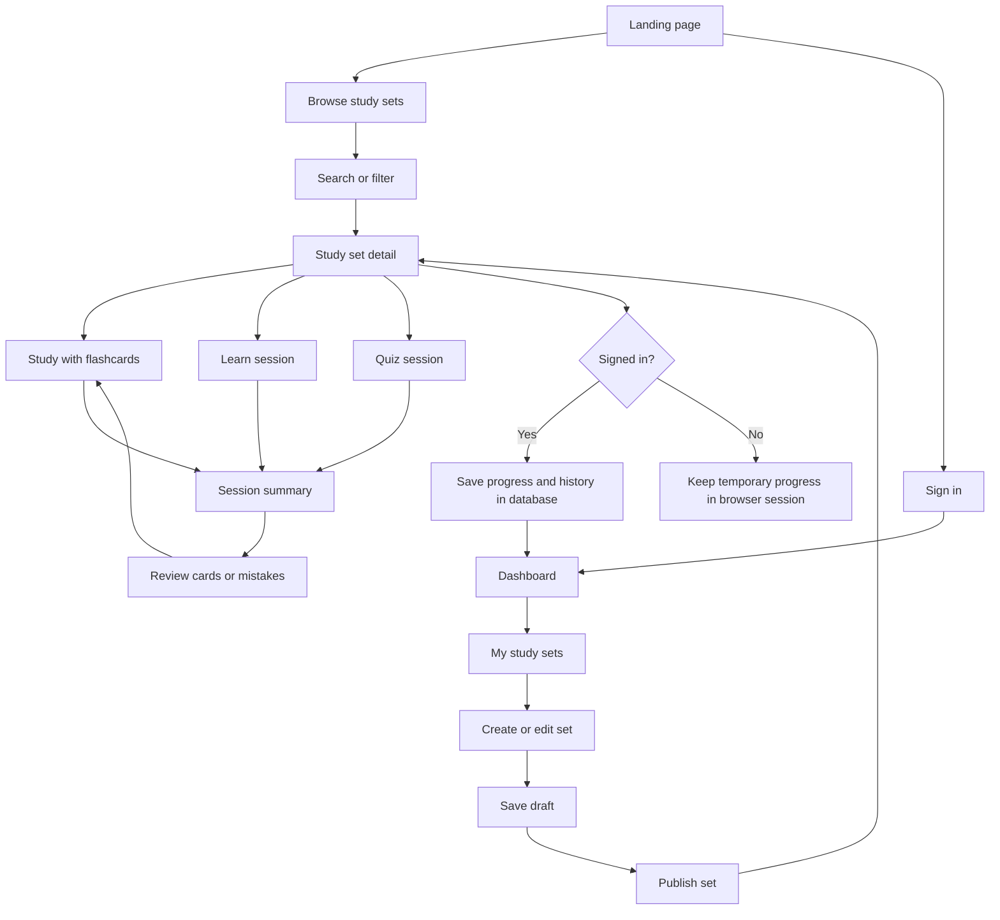
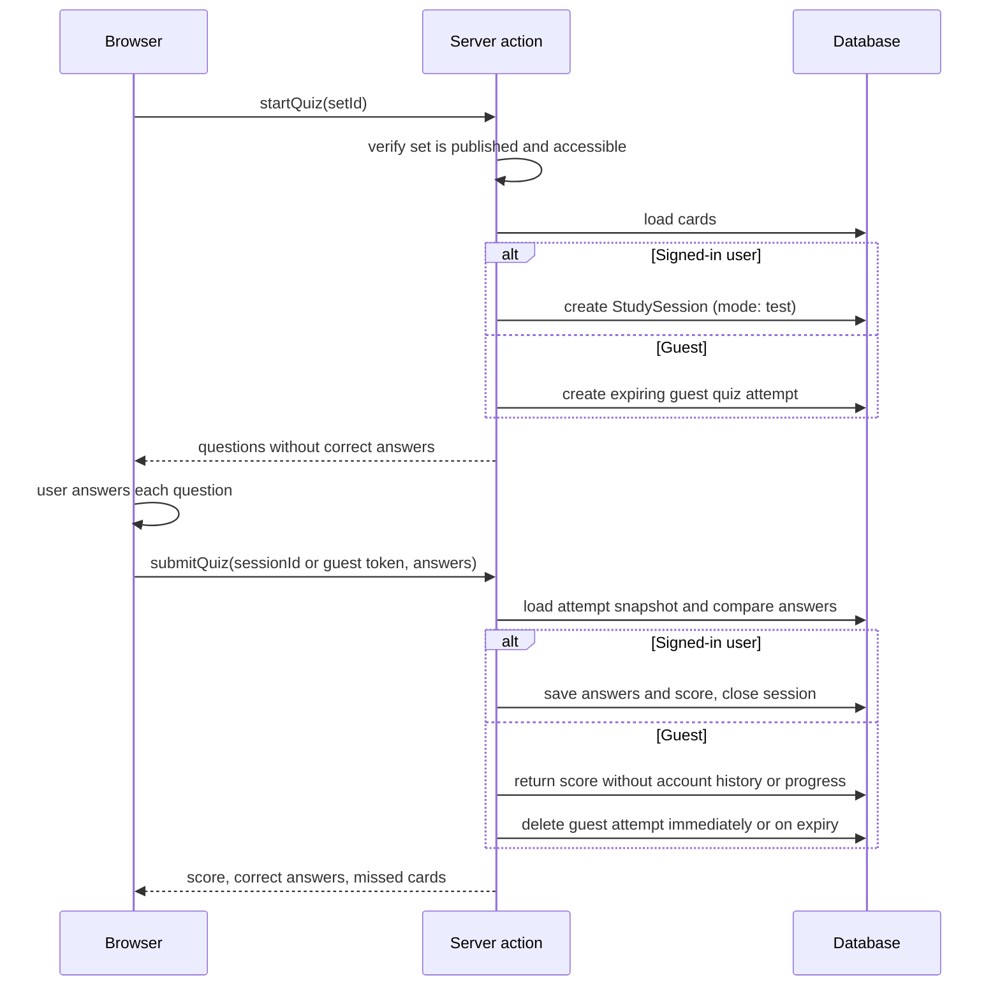
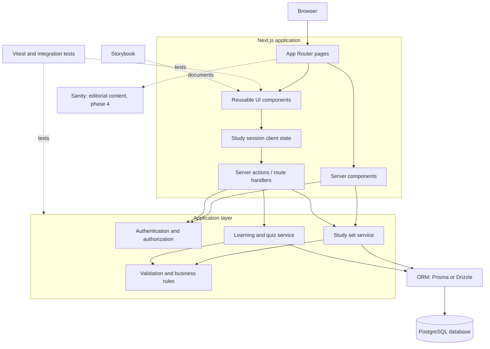

# User flows and architecture

How the app is used, how pages are organized, and how the pieces fit together.
For product scope see the [README](../README.md). For entities and types see [data-model.md](data-model.md).

## 1. Application map and user journeys



Anyone can open and study published public sets without signing in. Unlisted sets can also be studied by anyone with the link; private sets and drafts are owner-only. Signed-in users' progress and session history are saved in the database. Guest flashcard and Learn progress is kept in browser `sessionStorage` for the current tab, with a 24-hour maximum age, and is not saved to the database or transferred to an account. Guest quiz answers and progress are also temporary, but quiz scoring uses a short-lived server-side attempt so the browser cannot determine its own score. Guest quiz attempts expire after one hour and are deleted; they are not account history. Signing in enables saved, cross-session Learn progress and history.

## 2. Quiz flow: scoring on the server



The client never decides the score. Multiple-choice options are sent to the client, but the correct option is only revealed in the result. A guest token is an unguessable, short-lived capability for that quiz attempt only; it must not grant access to private sets or expose correct answers. Guest answer state in the browser is for continuity only and is never authoritative for scoring. Quiz results do not update Learn-mode `CardProgress`; only Learn answers do. If a guest attempt expires or is deleted before submission, the guest must start a new quiz.

## 3. Routes

Use `/sets` as the canonical public resource name: it is concise, reads naturally in URLs, and avoids making every route repeat “study.” Keep `/learn` as the name of the specific spaced-repetition mode; “study” is the broader activity that includes flashcards, Learn, and tests. Use `/my-sets` for the signed-in owner's management area. Route groups such as `(public)` organize the code and layouts. They do not appear in the URL.

| URL                        | Group         | Purpose                                        | Access                                          |
| -------------------------- | ------------- | ---------------------------------------------- | ----------------------------------------------- |
| `/`                        | `(public)`    | Landing page                                   | Everyone                                        |
| `/sets`                    | `(public)`    | Browse and search public sets (`?q=`, `?tag=`) | Everyone                                        |
| `/sets/[setId]`            | `(public)`    | Set detail                                     | Depends on visibility, see below                |
| `/sets/[setId]/flashcards` | `(public)`    | Flashcard study mode                           | Same as set detail                              |
| `/sets/[setId]/learn`      | `(public)`    | Spaced-repetition study mode                   | Same as set detail; progress saved if signed in |
| `/sets/[setId]/test`       | `(public)`    | Quiz study mode                                | Same as set detail                              |
| `/sessions/[sessionId]`    | `(dashboard)` | Saved session summary and review mistakes      | Session owner; signed-in sessions only          |
| `/login`, `/register`      | `(auth)`      | Authentication                                 | Signed-out users                                |
| `/dashboard`               | `(dashboard)` | Due cards, recent sets, streaks                | Signed-in                                       |
| `/my-sets`                 | `(dashboard)` | Your sets (drafts and published)               | Signed-in                                       |
| `/my-sets/new`             | `(dashboard)` | Create a set                                   | Signed-in                                       |
| `/my-sets/[setId]/edit`    | `(dashboard)` | Edit a set, publish, delete                    | Set owner                                       |
| `/settings`                | `(dashboard)` | Account, data export                           | Signed-in                                       |
| `/api/auth/[...nextauth]`  | `api`         | Auth.js handlers                               | Auth.js                                         |
| `/api/sets/[setId]/export` | `api`         | CSV export                                     | Same as set detail                              |

// TODO:: These are the recommended target URLs. The current app has `/learn/[id]` and `/study-sets/create`; align those routes with `/sets/[setId]/learn` and `/my-sets/new` as those features are wired to persisted sets.

## 4. Who can see what

| Set state              | Owner | Other signed-in users | Visitors      | Appears in search |
| ---------------------- | ----- | --------------------- | ------------- | ----------------- |
| Draft                  | Yes   | No                    | No            | No                |
| Published and private  | Yes   | No                    | No            | No                |
| Published and unlisted | Yes   | With the link         | With the link | No                |
| Published and public   | Yes   | Yes                   | Yes           | Yes               |

Visitors may study published public and unlisted sets without an account. Unlisted means not discoverable, not confidential: anyone with the link can share it. Every read and write checks access on the server. Hiding a button in the UI is not authorization. Guest flashcard and Learn progress is temporary browser session state and is not written to `StudySession`, `SessionAnswer`, or `CardProgress`. Guest quiz attempts are the exception: the server keeps only the short-lived attempt needed to score securely, then deletes it; it does not become account history or persistent progress.

## 5. Technical architecture



How to read it:

- **Reads** go through server components to the services, then the ORM, then the database.
- **Writes** (create set, submit quiz, save progress) go through server actions. The client study state calls them.
- **Authorization** is enforced in the application layer, not in the UI.
- **Sanity** is used only for the landing page, blog, and help content.

## 6. Frontend structure

The structure is organized by feature. Shared primitives live in `components/ui`. Everything that belongs to one domain lives in its feature folder.

```
src/
├── app/
│   ├── (public)/
│   │   ├── page.tsx
│   │   └── sets/
│   ├── (auth)/
│   │   ├── login/
│   │   └── register/
│   ├── (dashboard)/
│   │   ├── dashboard/
│   │   ├── my-sets/
│   │   ├── sessions/
│   │   └── settings/
│   ├── api/
│   └── layout.tsx
├── components/
│   └── ui/                  # primitives: Button, Input, Dialog, Tabs
├── features/
│   ├── study-sets/
│   │   ├── components/      # SetCard, CardEditor, SetForm
│   │   ├── schemas/         # Zod schemas
│   │   ├── services/        # server-only data access and rules
│   │   └── types/
│   ├── study-sessions/
│   │   ├── components/      # Flashcard, LearnPlayer, SessionSummary
│   │   ├── logic/           # pure functions: nextBox, calculateDueAt
│   │   ├── services/
│   │   └── types/
│   ├── quizzes/
│   │   ├── components/      # QuizQuestion, QuizResult
│   │   ├── logic/           # buildQuiz, scoreAnswer
│   │   └── services/
│   └── authentication/
├── lib/
│   ├── db/                  # ORM client
│   ├── auth/                # Auth.js config, getCurrentUser, requireUser
│   ├── sanity/              # client and GROQ queries (phase 4)
│   └── utils/
├── styles/                  # tokens.css, reset.css, global.css
└── test/                    # test setup, factories, shared mocks
```

**Rules**

- A feature may import from `components/ui` and `lib`. It should not import from another feature's internals.
- Components never query the database. They call services.
- Services are marked `server-only`.
- Each component keeps its `.tsx`, `.module.css`, `.stories.tsx`, and `.test.tsx` together.
- Pure logic lives in `logic/` folders and has no React or database imports.

### Server and client components

| Component                                   | Type              | Why                                                               |
| ------------------------------------------- | ----------------- | ----------------------------------------------------------------- |
| Set list, set detail, summary               | Server            | Read-only, no browser APIs needed                                 |
| Flashcard player, Learn player, Quiz player | Client            | Local state, keyboard events, animation                           |
| Set editor form                             | Client            | Dynamic rows, validation feedback                                 |
| `components/ui` primitives                  | Server by default | Add `use client` only when a primitive needs state (Dialog, Tabs) |

## 7. Open questions

- Which OAuth provider: GitHub or Google?
- Prisma or Drizzle?
- Is Match mode included before launch or after?
- Do quiz results need explanations beyond the card definition? If yes, add an optional `explanation` field to `Card`.
